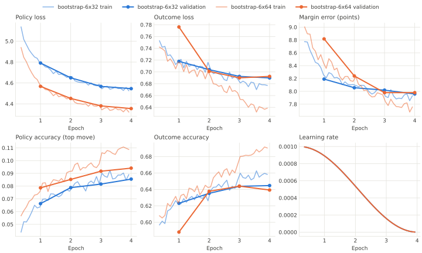

# BlokusZero

October 2026. How strong is a BlokusZero network, with and without search,
and how should the search be set up for match play? `main:match` results,
2-player, single thread, A's score with a 95% CI, 100 games each. The
opponent is the default MCTS (`c` 0.25, `size_bias` 1) unless noted.
Results are in [`data/blokuszero.txt`](data/blokuszero.txt). The plan is in
[`zero/PLAN.md`](../zero/PLAN.md).

## Summary

- The **bootstrap network** (6 x 32, 125k parameters, trained on 5,000
  games of 1000-iteration MCTS self-play) playing **its policy alone** is
  about as strong as **300-iteration MCTS**, at about 2 ms a move.
- With **Gumbel search** (`ZeroAI`) and no Gumbel noise, it is about as
  strong as **1000-iteration MCTS** at 32 simulations (0.565–0.585), and
  beats it **0.71 ± 0.09 at 128 simulations with 32 or 64 candidates**
  (about +150 Elo), in about 1.5x MCTS's time per move.
- **Gumbel noise ruins match play** with this network: the same search
  with `gumbel_scale` 1 scores 0.04–0.155 against 1000-iteration MCTS,
  worse than the policy alone. The noise is for self-play; matches use 0.
- **Width beats depth** at 128 simulations: 32 candidates score 0.705
  against 0.525 for 16. With a flat policy and a weak value head, checking
  more moves pays more than checking a few deeper.
- **The value head is limited by the data.** It's calibrated but weak: 50%
  outcome accuracy in the opening and only 80% in the last moves, where the
  result is nearly decided. A **6 x 64 network** (471k parameters) trained
  on the same games learned no better a value head, and started to overfit
  the 5,000 results. More games (self-play) should help more than size.
- **A better policy makes a much stronger search.** 6 x 64's policy is
  clearly better, and with search it beats 1000-iteration MCTS **0.76 ±
  0.08 at 32 simulations and 0.93 ± 0.05 at 128** (6 x 32: 0.585 and
  0.705). At equal time, 32 simulations of 6 x 64 are about as strong as
  128 of 6 x 32.

## The bootstrap network

`zero:generate` played 5,000 games of 1000-iteration MCTS against itself
(the first 8 moves sampled in proportion to visits), recording each move's
root visits as the policy target: 319,232 positions in 10 shards. MCTS's
most-visited move averages 18% of the visits, so the targets are flat.
`train.py` trained 6 x 32 for 4 epochs (batch 256, AdamW, lr 1e-3 with
warmup and cosine decay) on 9 shards, holding out the last. That took an
hour at about 330 examples a second.

Validation after each epoch:

| Epoch | Policy loss | Top move = MCTS's most-visited | Outcome accuracy | Margin error |
|---|---|---|---|---|
| 1 | 4.79 | 6.6% | 62.3% | 8.2 pts |
| 2 | 4.65 | 7.9% | 63.5% | 8.1 pts |
| 3 | 4.57 | 8.2% | 64.4% | 8.0 pts |
| 4 | 4.55 | 8.6% | 64.5% | 7.96 pts |

The targets' entropy is 2.81, the lowest possible policy loss, so the
policy is about 1.7 nats short of matching MCTS. Training and validation
losses tracked each other, and validation was still improving.

The value head by stage of the game (validation shard):

| Moves into the game | Outcome accuracy | Mean confidence | Margin error |
|---|---|---|---|
| 0–16 | 50% | 0.52 | 9.3 pts |
| 16–32 | 60% | 0.61 | 8.8 |
| 32–48 | 69% | 0.70 | 7.8 |
| 48–64 | 76% | 0.77 | 6.6 |
| 64+ | 80% | 0.81 | 5.3 |

Its confidence matches its accuracy, so it knows what it doesn't know.
Late in the game the score is mostly fixed by the tiles each color has
left, which are inputs, so missing the margin by 5 points there looked like
too little capacity. A larger network didn't do better, though (below).

## Policy alone

`PolicyAI` plays the legal move with the largest prior:

| Opponent | Wins-ties-losses | Score | Mean margin |
|---|---|---|---|
| Random | 100-0-0 | 1.00 | +36.1 |
| MCTS 10 | 96-0-4 | 0.96 ± 0.04 | +35.1 |
| MCTS 100 | 83-0-17 | 0.83 ± 0.07 | +24.9 |
| MCTS 300 | 50-0-50 | 0.50 ± 0.10 | +10.9 |
| MCTS 1000 | 8-0-92 | 0.08 ± 0.05 | -9.1 |

## Gumbel search

`ZeroAI` runs Gumbel MCTS (`zero/search.h`): it picks `num_considered`
root candidates by Gumbel top-k from the policy, spreads the simulations
over them by sequential halving, and plays the remaining candidate with
the highest logit + sigma(completed Q). Inside the tree it picks the move
whose visit share lags its improved policy the most.

### Gumbel noise

With noise (`gumbel_scale` 1, 16 candidates), against MCTS 1000:

| Simulations | Wins-ties-losses | Score |
|---|---|---|
| 16 | 0-0-56 (stopped) | 0.00 |
| 32 | 1-0-49 (stopped) | 0.01 |
| 64 | 4-0-96 | 0.04 ± 0.04 |
| 128 | 14-3-83 | 0.155 ± 0.07 |

All worse than the policy alone (0.08). Gumbel top-k samples the
candidates from the policy, and with no informative search the final
choice is a sample from the policy too. Sampling from a policy this flat
plays much worse than taking its top move, and the value head can't
rescue the bad candidates. Head to head against `PolicyAI`, 32 simulations
with noise scored 0.475 ± 0.095.

The noise is what makes Gumbel search improve the policy in expectation
at few simulations, and it gives self-play its exploration. In a match it
only costs strength; mctx also suggests 0 for evaluation. Without noise
the root takes the candidates with the largest priors and the search is
deterministic.

### Simulations and candidates

No noise, against MCTS 1000:

| Simulations | Candidates | Wins-ties-losses | Score | Mean margin | Time, zero vs MCTS |
|---|---|---|---|---|---|
| 32 | 16 | 56-1-43 | 0.565 ± 0.10 | +12.6 | 2.9 vs 6.9 min |
| 32 | 32 | 58-1-41 | 0.585 ± 0.10 | +12.0 | 4.1 vs 9.1 min |
| 32 | 64 | 58-1-41 | 0.585 ± 0.10 | +12.0 | 4.0 vs 9.1 min |
| 128 | 16 | 51-3-46 | 0.525 ± 0.10 | +9.5 | 9.6 vs 6.3 min |
| 128 | 32 | 70-1-29 | 0.705 ± 0.09 | +15.3 | 12.4 vs 8.0 min |
| 128 | 64 | 70-2-28 | 0.71 ± 0.09 | +18.5 | 12.5 vs 8.1 min |

Times are totals over the match, with four matches sharing the machine, so
they're inflated; compare the two sides within a row.

- **At 32 simulations** the search is mostly a one-move lookahead by the
  value head over the top candidates. 32 and 64 candidates played
  identical games: the first halving round gives each candidate one
  simulation, so 32 simulations reach only the top 32 either way, and an
  unvisited candidate never beat the best visited one.
- **At 128 simulations**, 16 candidates get 2 simulations each, then 8 get
  4, 4 get 8, and the last 2 get 16: deep on few moves. 32 candidates
  spread the budget over twice as many. The difference, 0.18 ± 0.13, is
  significant.
- 128 simulations with 16 candidates was no better than 32 simulations.
  Extra depth only helps if the leaf values are good.

## A larger network

`train.py` trained 6 x 64 (471k parameters, 182M multiply-adds an
evaluation against 47M) on the same shards with the same settings. It took
about 2 hours 45 minutes at about 117 examples a second.

Validation after 4 epochs:

| Network | Policy loss | Top move = MCTS's most-visited | Outcome loss | Outcome accuracy | Margin error |
|---|---|---|---|---|---|
| 6 x 32 | 4.55 | 8.6% | 0.690 | 64.5% | 7.96 pts |
| 6 x 64 | 4.35 | 9.4% | 0.692 | 63.9% | 7.98 pts |

Training curves for both networks. Training metrics are averaged over each
100 steps; validation is on the held-out shard after each epoch:

- **The policy doesn't overfit.** Training and validation policy loss
  track each other for both networks, and are still falling when the
  learning rate reaches 0. 6 x 64 is ahead from the first epoch.
- **6 x 64's value head overfits from the second epoch.** Its training
  outcome loss falls to 0.64 and training accuracy rises to 69%, while
  validation flattens at 0.69 and 64%. The training curves jump at each
  epoch boundary, when the net sees the same games again: it is learning
  the games, not the positions. 6 x 32 shows a smaller gap in the last
  epoch (0.68 against 0.69).
- 6 x 64's first-epoch validation value was poor (0.78 loss, 59%) while its
  training value was fine; it was probably caught at a bad point at the
  peak learning rate.

The value head by stage of the game (validation shard):

| Moves into the game | Accuracy, 6 x 32 / 6 x 64 | Mean confidence | Margin error |
|---|---|---|---|
| 0–16 | 50% / 48% | 0.52 / 0.53 | 9.3 / 9.3 pts |
| 16–32 | 60% / 59% | 0.61 / 0.62 | 8.8 / 8.9 |
| 32–48 | 69% / 69% | 0.70 / 0.72 | 7.8 / 7.8 |
| 48–64 | 76% / 76% | 0.77 / 0.79 | 6.6 / 6.5 |
| 64+ | 80% / 82% | 0.81 / 0.83 | 5.3 / 5.6 |

- **The policy improved by 0.19 nats**, as much as 6 x 32 gained in its
  last two epochs, and was still improving.
- **The value head did not improve at any stage**, and 6 x 64 is 1–5
  points more confident than it is accurate. Its validation outcome loss
  rose slightly in the last epoch while the training loss kept falling: it
  is beginning to memorize the 5,000 results. A game's positions are highly
  correlated, so 319k positions hold only 5,000 independent outcomes.

Gumbel search, 32 candidates, no noise, against MCTS 1000:

| Network | Simulations | Wins-ties-losses | Score | Mean margin | Time, zero vs MCTS |
|---|---|---|---|---|---|
| 6 x 32 | 32 | 58-1-41 | 0.585 ± 0.10 | +12.0 | 4.1 vs 9.1 min |
| 6 x 32 | 128 | 70-1-29 | 0.705 ± 0.09 | +15.3 | 12.4 vs 8.0 min |
| 6 x 64 | 32 | 76-0-24 | 0.76 ± 0.08 | +22.8 | 13.1 vs 9.0 min |
| 6 x 64 | 128 | 93-0-7 | 0.93 ± 0.05 | +30.3 | 36.1 vs 6.7 min |

Again four matches shared the machine. With the same value head, the
better policy gains 0.175 at 32 simulations and 0.225 at 128 (+460 Elo
over MCTS 1000 at 128, against +150). The policy picks the candidates and
their priors, and a value head this weak can only choose well among good
candidates. At equal time (6 x 64 at 32 against 6 x 32 at 128, about 12–13
minutes each) the larger network is as good or slightly better, 0.76
against 0.705, within the noise.

Head-to-head matches between the two networks were meaningless: without
Gumbel noise both players are deterministic, so each match repeated one
game per seat 50 times (50-0-50 at 32 simulations each; 100-0-0 for 6 x 64
at 32 against 6 x 32 at 128). Comparing zero players directly needs varied
games, for example random opening moves.

## Open questions

- Does more data (self-play, or more MCTS games) improve the value head,
  and does the search then gain more from simulations?
- Per-node rescaling of Q to [0, 1] (mctx's default) turns any value gap
  between candidates, however small, into about 5 logits, which swamps the
  prior. Without rescaling, the prior would keep more weight while the
  value head is weak.
- At equal time per move, how does `ZeroAI` compare with MCTS at 10k
  iterations (about 2.5 s a move)?
